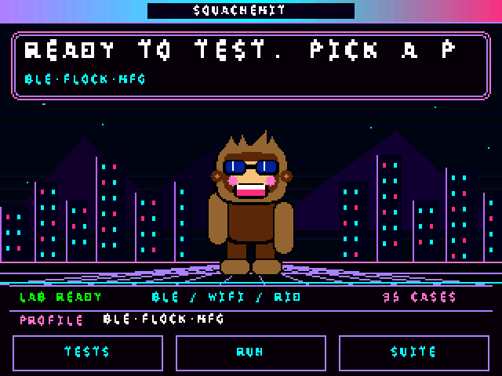
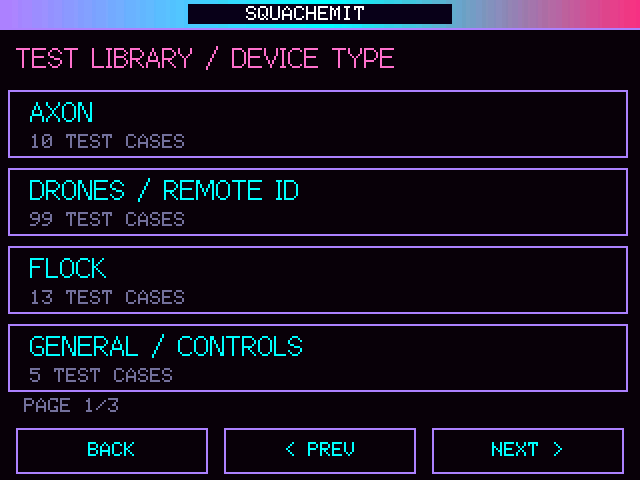
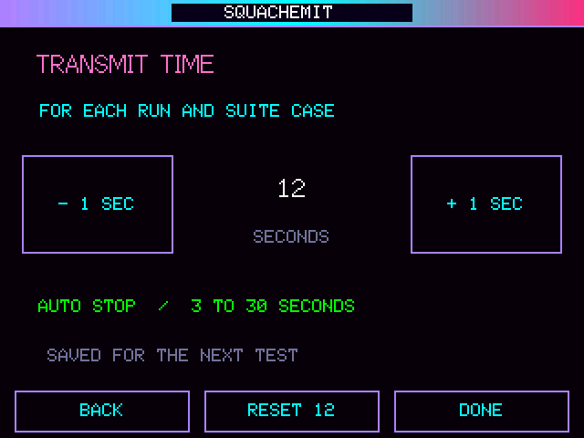
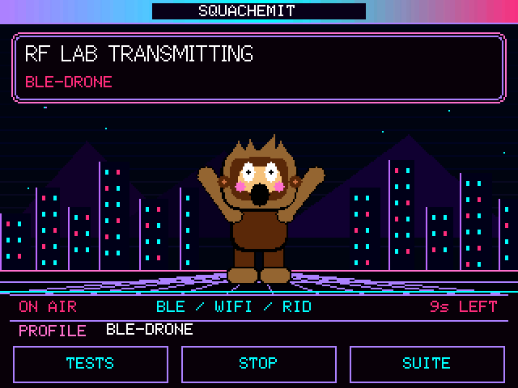

# SquachEmit

**An ESP32 signal emulator for testing SquachWatch detection accuracy.**

[Web Installer](https://retrodroid32.github.io/SquachEmit/) · [v1.1.0 Public Release](https://github.com/retrodroid32/SquachEmit/releases/tag/v1.1.0) · [SquachWatch-CYD](https://github.com/retrodroid32/SquachWatch-CYD) · [Report an Issue](https://github.com/retrodroid32/SquachEmit/issues)

SquachEmit is a standalone, open-source test transmitter built to exercise the detection signatures used by [SquachWatch-CYD](https://github.com/retrodroid32/SquachWatch-CYD). It broadcasts **synthetic, time-limited BLE advertisements and ordinary 2.4 GHz Wi-Fi test signals**, while separate offline fixtures cover additional receiver-only patterns.

The purpose is to measure **hits, misses, false positives, classification accuracy, and detection latency** using controlled test cases. A test signal resembling a named product **does not authenticate that product or indicate its real-world presence**.

> **Current public release: v1.1.0 — 172-Case Detection Suite & Smooth Touch.** The CYD 3.2 has been flashed and tested during development; all three board targets are compiled in GitHub CI. That is not a claim of C5/S3 physical verification or hardware certification. See the [v1.1.0 release notes](docs/RELEASE_V1.1.0.md) for the exact changes and limitations.


<p align="center">
  <a href="https://retrodroid32.github.io/SquachEmit/">
    
  </a>
</p>

<p align="center"><b>Firmware-rendered Squachy animation and test workflow.</b> <a href="https://retrodroid32.github.io/SquachEmit/">Flash it directly in your browser.</a></p>

## SquachEmit in motion

The animations below are generated by compiling **SquachEmit's actual CYD 3.2 C++ firmware UI renderer** with a host-based TFT display backend. They show Squachy's actual animations, the **current 172-case device library**, and the adjustable TX-time editor—not a stock animation or AI concept art. The earlier tagged v1.0.0 release retains its original 95 cases.

<p align="center">
  <b>The actual firmware UI, rendered on a computer from the same C++ drawing code used on the CYD.</b><br>
  <a href="https://retrodroid32.github.io/SquachEmit/"><b>Open the web installer</b></a> ·
  <a href="docs/README_UI_ANIMATIONS.md"><b>How the animations are generated</b></a>
</p>

### Explore the library

<p align="center">
  
</p>

The **172 current-main test cases** are organized into exclusive device-type libraries, not split or duplicated by BLE versus Wi-Fi. Each family and its negative controls stay together; navigation is alphabetical.

### Adjust the transmit duration

<p align="center">
  
</p>

On the CYD 3.2, tap **TX TIME [SET]** on the home status strip. Use **− 1 SEC** or **+ 1 SEC** (3–30 seconds), **RESET 12**, and **DONE**. The duration is saved across reboots and applies to touchscreen **RUN**, **SUITE** cases, and serial RUN commands without an explicit duration. An explicit serial duration still overrides it for that command. Duration changes update only the value area, avoiding unnecessary screen flashing.

### Run a synthetic signal

<p align="center">
  
</p>

Tests transmit only after an explicit start and automatically stop at the configured duration. In the animations above, **no radio was transmitted**—the C++ firmware interface is rendered using a host display adapter.


## Version and What Changed

**Latest public version: v1.1.0 — 172-Case Detection Suite & Smooth Touch**

Compared with the original 95-case `v1.0.0`, the current release contains **172 synthetic test scenarios**, 27 added UAS vendor-prefix Wi-Fi beacon cases, a **saved 3–30-second TX-time editor** for CYD 3.2, smoother touch rendering, four-part **SHA-256 browser flashing checks**, clearer build titles and detailed change descriptions, four updated README animations, and **ten native SquachWatch DJI OUI offline decoding tests**.

The default web installer shows the exact **FIRMWARE**, **VERSION**, and **WHAT CHANGED** for the chosen board and source commit. See [complete v1.1.0 release notes](docs/RELEASE_V1.1.0.md) and [GitHub release assets](https://github.com/retrodroid32/SquachEmit/releases/tag/v1.1.0).

## Install — browser only

**Recommended method: [Open the SquachEmit Web Installer](https://retrodroid32.github.io/SquachEmit/)**

1. Connect the intended SquachEmit ESP32 board using a **USB data cable** and desktop Chrome or Edge.
2. Select the **exact board model**; firmware builds are not interchangeable.
3. Select the **SquachEmit v1.1.0 — 172-Case Detection Suite** public firmware shown for your board. Check **VERSION** and **WHAT CHANGED** before installing.
4. Confirm the board and use **Install** to flash directly in the browser.
5. For test commands, use the installer's built-in **Serial Test Console** (115200 baud by default, with selectable baud rates).

There is **no requirement to download firmware files or run a manual flasher**. GitHub release assets are retained for reproducibility, while browser flashing is the primary installation workflow. A separate [LAB channel](https://retrodroid32.github.io/SquachEmit/?lab=1) exposes unverified experimental builds.

**Warning:** Flashing SquachEmit onto a CYD replaces the firmware currently on that device, including SquachWatch. Use a **separate device** as the SquachWatch receiver.

## Hardware targets

| Board | Display/interface | Firmware |
|---|---|---|
| **CYD 3.2 ST7798** (ESP32-2432S032R / E32R32P) | 3.2-inch resistive touchscreen; animated Squachy, device-type test library | v1.1.0 public build; owner flashed/tested CYD 3.2, no certification |
| **Waveshare ESP32-C5 Touch LCD 2.8** | ST7789, CST3530 capacitive touch | v1.1.0 public build; CI compiled, hardware verification pending |
| **ESP32-S3 DevKitC-1** | USB serial test console | v1.1.0 public build; CI compiled, hardware verification pending |

The Waveshare C5 profile is **not** interchangeable with other ESP32-C5 2.8-inch touchscreen boards, and CYD 3.2 firmware is **not** compatible with CYD 2.8. See [CYD hardware notes](docs/CYD32-LAB.md) and [Waveshare C5 details](docs/WAVESHARE-C5.md).

The ESP32 hardware cannot reproduce every radio protocol: e.g., 5 GHz Wi-Fi, Bluetooth Classic inquiry, BLE 5 extended/coded PHY, proprietary drone links, and arbitrary 802.11 management frames require different hardware or offline receiver fixtures.

## 172 test cases on current main — one device family per library

**The CYD 3.2 on-screen library groups cases by device type, not by BLE versus Wi-Fi.** Each case appears exactly once, in its matching category; categories and test IDs are alphabetically ordered.

| Device library | Examples |
|---|---|
| **Axon** | Body 2/3/4 pairing SSIDs, Field patterns, near-match controls |
| **Drones / Remote ID** | DJI, Autel, Parrot, generic OpenDroneID, stale/invalid message controls |
| **Flock** | Setup SSIDs, Penguin battery names, vendor ID and negative controls |
| **General / Controls** | Generic benign/unknown radio fixtures |
| **Hacker Devices** | Flipper UUID/name patterns, Pineapple/Pager SSIDs, negatives |
| **iBeacon** | Structured Apple iBeacon positives and malformed controls |
| **Raven** | Service UUID family and nonmatching adjacent UUID |
| **Serial Modules** | HC-series, JDY-series, RN42, linvor and other **candidate** device names |
| **Smart Glasses** | Meta, Luxottica, Snap company IDs and Ray-Ban Meta service UUID |
| **Trackers** | AirTag-like Find My patterns, Samsung SmartTag, Tile, Eddystone controls |

For example, a drone's BLE and Wi-Fi Remote ID cases are **both found only under Drones / Remote ID**, never duplicated under a generic BLE list. BLE/Wi-Fi are still recorded as technical transmission details.

Coverage notes: [original 95-case detection matrix](docs/DETECTION_MATRIX_95.md) · [device-type library](docs/DEVICE_TYPE_LIBRARY.md) · [drone variants](docs/DRONE-LAB.md).

**Interpretation matters:** A generic Bluetooth serial module is not necessarily a card skimmer. A Meta company ID is not proof of camera glasses. The generic Eddystone UUID `0xFEAA` alone is **not** proof of a Google tracker. Negative cases exist to catch such false positives.

## Running a test

Select a profile on the touchscreen or use the **Serial Test Console** in the web installer:

```text
HELP
LIST
RUN BLE-META-UUID 12
RUN RID-DJI-MINI 12
RUN WIFI-AXON-AB4 12
STATUS
STOP
SUITE
```

`RUN <ID> [seconds]` accepts 3–30 seconds per case; the CYD 3.2 defaults to 12 seconds and remembers the duration selected on its touchscreen. The device does not transmit automatically at boot. `STOP` immediately ends the active case or suite. A full 172-case suite takes time; run it only while attended and monitor your receiver.

A typical result contains a `TRUTH` record with the case ID and expected classification. **This records the transmitter's intention**, not proof that another device actually received or recognized the signal.

For meaningful results, use a separate SquachWatch receiver (CYD 2.8 or 3.2), test positive and negative controls, and record observed classifications and latency in `tests/observations.csv`. See [accuracy testing](docs/ACCURACY.md), [limitations](docs/LIMITATIONS.md), and [trial scoring](docs/LAB-EXPANSION.md).

## What's covered offline, not transmitted

The fixture library also tests receiver behavior for vendor OUIs (cameras, ALPR, Ring, drone manufacturers), Flock wildcard-probe corroboration, evil-twin frame relationships, Pwnagotchi identifiers, Wi-Fi Remote ID NAN, and deauthentication thresholds. Those are **offline test vectors**, **not** emitted spoofed manufacturer identities or attack traffic.

SquachEmit does **not** broadcast deauth floods, jam networks, collect credentials, or reproduce private drone flight links. Use it only in environments and with radio equipment you control or are authorized to test, following applicable RF rules.

## Development, provenance and licensing

Code and test cases: `src/`, `include/`, and `tests/`. Automated workflow: [SquachEmit CI](https://github.com/retrodroid32/SquachEmit/actions/workflows/ci.yml). Version details: [v1.0.0 release notes](docs/RELEASE_V1.0.0.md). The release's source-derived Squachy core is documented in [Squachy port provenance](docs/SQUACHY-PORT.md); it incorporates GPL-3.0-only source adaptations from SquachWatch. Other MIT-authored portions retain their notices. **The combined distributed firmware must satisfy GPLv3 obligations**; see `LICENSE` and `LICENSES/GPL-3.0.txt`.

SquachEmit and SquachWatch-CYD are separate firmware projects. SquachEmit is not affiliated with the device manufacturers referenced by its detection test cases.

## Contributing and reporting bugs

Open a [GitHub issue](https://github.com/retrodroid32/SquachEmit/issues) with the exact board, the firmware version, steps to reproduce, actual versus expected result, and relevant console log. Hardware-tested reports are especially valuable; **CI pass does not mean physical validation**.
